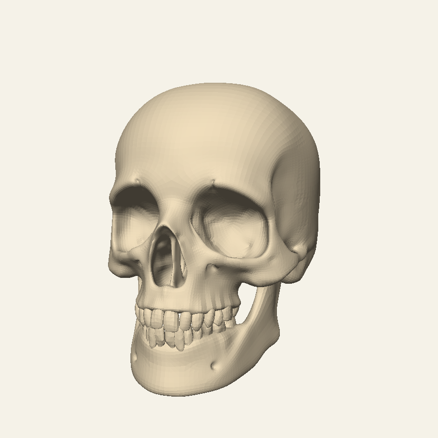
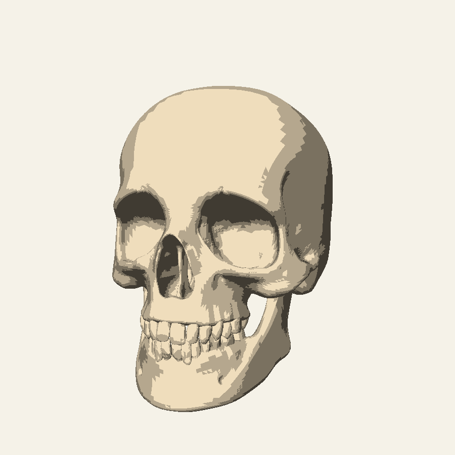
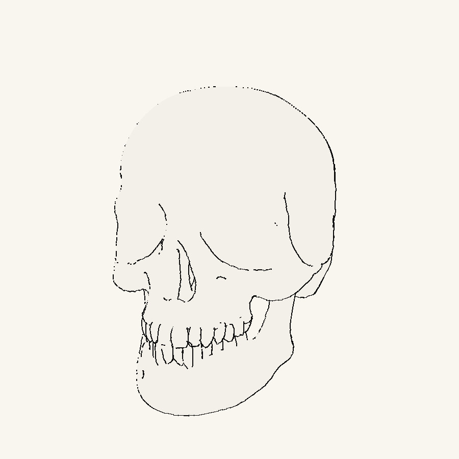
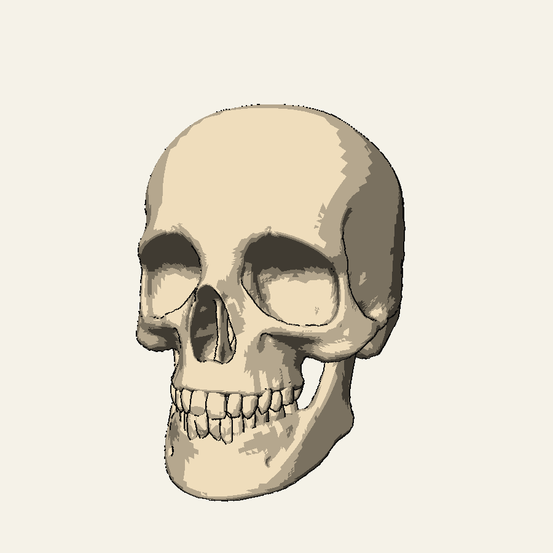

# Non-Photorealistic 3D Renderer

A Python-based software renderer that converts 3D meshes into stylised images using toon shading, view-dependent contour extraction, and manga-inspired hatching. Developed for a Computer Science graphics project at the University of Bath.

## Results

The renderer generates five images from the same camera position:

| Reference shading | Toon shading |
| --- | --- |
|  |  |

| Contours | Toon shading + contours |
| --- | --- |
|  |  |

**Creative extension: manga-style hatching**


## How it works

The rendering pipeline:

1. Loads a triangular 3D mesh and centres/scales it.
2. Projects vertices into screen coordinates using a configurable perspective camera.
3. Rasterises triangles in software with barycentric coordinates and a depth buffer.
4. Produces reference shading and quantised toon-shading bands.
5. Identifies view-dependent contour edges where adjacent faces have opposite camera-facing orientations, and tests line visibility against the depth buffer.
6. Optionally adds light-dependent hatching and cross-hatching to shadowed surfaces.

The rasterisation and stylisation logic is implemented in Python rather than through OpenGL or a game engine.

## Technologies

- **Python** — rendering pipeline and command-line interface
- **NumPy** — vector and matrix operations
- **trimesh** — 3D mesh import and preprocessing
- **Pillow** — image output and line drawing

## Installation

Requires Python 3.

```bash
python3 -m pip install -r requirements.txt
```

## Running the renderer

Provide a supported 3D mesh (OBJ, PLY, or STL). For a skull model saved as `skull model/12140_Skull_v3_L2.obj`, run:

```bash
python3 graphicsrenderer.py --mesh "skull model/12140_Skull_v3_L2.obj" --out "outputs/skull_final_simple" --creative --eye "1.0,-3.0,0.3" --up "0,0,1"
```

The script saves the reference, toon, contour, and combined images to `outputs/`, plus the creative hatching output when `--creative` is enabled.

Camera, image dimensions, field of view, and number of toon bands can be adjusted through command-line options. Run `python3 graphicsrenderer.py --help` to see them.

